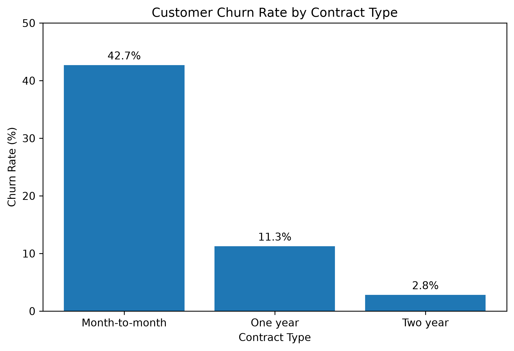
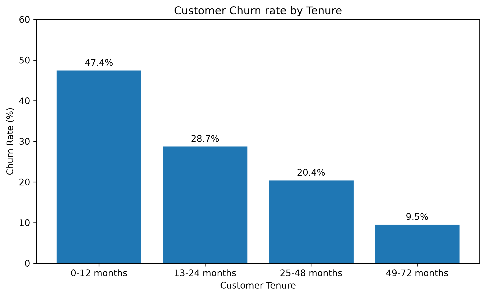
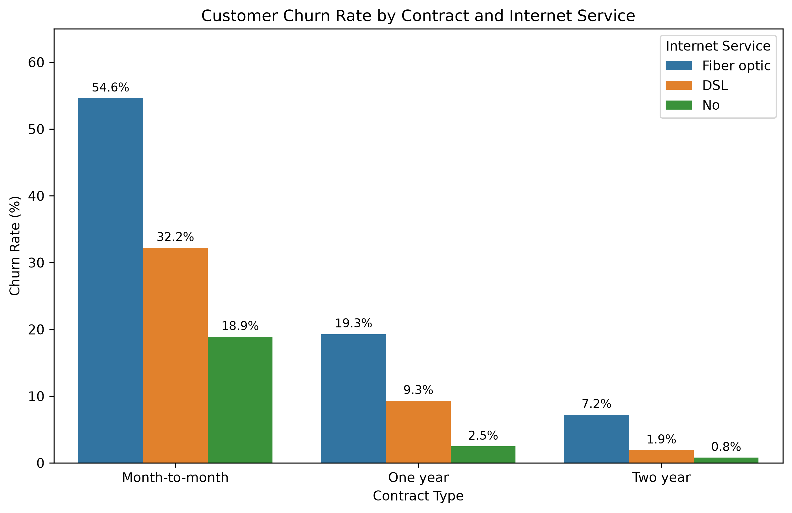

# Customer Churn & Retention Analysis

## Project Overview

This project analyzes telecommunications customer data to identify characteristics associated with customer churn and explore opportunities to improve customer retention.

Using **Python, Pandas, Matplotlib, and Seaborn**, I performed data cleaning, exploratory data analysis (EDA), and visualization to investigate how contract type, customer tenure, monthly charges, and internet service type relate to customer churn.

The objective is to translate customer data into actionable business insights that could help a telecommunications company develop more effective retention strategies.

**Project Status:** Analysis and Visualizations Completed

## Tools & Technologies

- **Python:** Data analysis and processing
- **Pandas:** Data cleaning, aggregation, grouping, and exploratory analysis
- **Matplotlib:** Data visualization and chart customization
- **Seaborn:** Statistical visualizations and customer segment comparisons
- **Jupyter Notebook:** Analysis documentation and code execution
- **Git & GitHub:** Version control and project documentation

## Dataset

**Source:** [Telco Customer Churn — Kaggle](https://www.kaggle.com/datasets/blastchar/telco-customer-churn)

The dataset contains 7,043 customer records and 21 original columns from an IBM telecommunications sample dataset.

It includes information about:

- Customer demographics
- Contract types and tenure
- Internet and phone services
- Monthly and total charges
- Payment methods
- Customer churn status

The `Churn` column indicates whether a customer left the company.

## Business Questions

This project investigates the following questions:

1. What percentage of customers churned?
2. Which contract types have the highest churn rates?
3. How does customer tenure relate to churn?
4. Are higher monthly charges associated with customer churn?
5. Which internet service categories experience the highest churn?
6. Does the relationship between internet service type and churn remain when comparing customers within the same contract type?

## Project Methodology

### 1. Data Exploration

- Imported and examined the dataset using Pandas.
- Inspected the dataset's dimensions, column names, data types, and descriptive statistics.
- Analyzed the distribution of customer churn.
- Identified variables relevant to customer retention.

### 2. Data Cleaning

- Identified 11 blank values in `TotalCharges`.
- Converted `TotalCharges` from a string to a numeric data type.
- Found that all 11 affected customers had zero months of tenure.
- Replaced missing `TotalCharges` values with zero, assuming these customers had not yet accumulated charges.
- Verified that no duplicate customer records or customer IDs were present.
- Converted the `SeniorCitizen` column from numeric codes (0 and 1) into readable Yes/No categories.

### 3. Exploratory Data Analysis

Used Pandas aggregation, `groupby()`, `value_counts()`, `pd.cut()`, and `pd.crosstab()` to investigate:

- Overall churn rates
- Churn by contract type
- Churn by customer tenure
- Churn by monthly charges
- Churn by internet service type
- Churn across combinations of internet service and contract type

### 4. Data Visualization

Created visualizations using Matplotlib and Seaborn to communicate the results:

1. Overall Customer Churn Rate
2. Customer Churn Rate by Contract Type
3. Customer Churn Rate by Tenure
4. Monthly Charges by Churn Status
5. Customer Churn Rate by Contract and Internet Service

## Key Findings

### 1. Overall Customer Churn

Of the 7,043 customers analyzed:

| Churn Status | Customers | Percentage |
|---|---:|---:|
| Churned | 1,869 | 26.54% |
| Retained | 5,174 | 73.46% |

Approximately one in four customers in the dataset had churned.

### 2. Contract Type and Churn

| Contract Type | Churn Rate |
|---|---:|
| Month-to-month | 42.71% |
| One year | 11.27% |
| Two year | 2.83% |

Customers with month-to-month contracts experienced substantially higher churn rates than customers with one-year or two-year agreements.

**Business insight:** Month-to-month customers represent an important segment for further retention analysis.

### 3. Customer Tenure and Churn

- Average tenure of churned customers: **17.98 months**
- Average tenure of retained customers: **37.57 months**
- Customers with 0–12 months of tenure had a churn rate of approximately **47.44%**, the highest among the tenure groups analyzed.

Observed churn rates decreased across longer-tenure groups.

**Business insight:** Newer customers may benefit from improved onboarding and proactive retention initiatives.

### 4. Monthly Charges and Churn

| Monthly Charge Metric | Churned | Retained |
|---|---:|---:|
| Average | $74.44 | $61.27 |
| Median | $79.65 | $64.43 |

Customers who churned generally had higher monthly charges than customers who stayed.

The $70–$100 monthly charge category had the highest observed churn rate among the defined charge groups.

**Business insight:** Higher monthly charges are associated with churn, although differences in services and contract terms may contribute to the relationship.

### 5. Internet Service Type and Churn

| Internet Service | Churn Rate |
|---|---:|
| Fiber optic | 41.89% |
| DSL | 18.96% |
| No internet service | 7.40% |

Fiber-optic subscribers experienced the highest observed churn rate.

Further analysis showed that fiber-optic customers had higher churn rates than DSL customers within month-to-month, one-year, and two-year contract categories.

**Business insight:** Differences in contract type alone do not fully explain the higher observed churn among fiber-optic customers.

## Business Recommendations

### 1. Improve Early Customer Retention

Investigate retention initiatives for customers within their first 12 months of service.

Potential strategies include improved onboarding, proactive customer support, and satisfaction check-ins.

### 2. Test Incentives for Longer Contracts

Consider offering eligible month-to-month customers loyalty benefits or promotional incentives for longer-term contracts.

Test these offers to evaluate their impact on retention, customer satisfaction, and profitability.

### 3. Investigate Fiber-Optic Customer Experience

Because fiber-optic customers have the highest observed churn rate, investigate possible concerns related to pricing, service reliability, and customer support.

Additional information such as cancellation reasons, customer feedback, and service outage history would help identify potential causes.

### 4. Evaluate Targeted Retention Offers

Explore personalized retention strategies for higher-paying customer segments instead of implementing broad price reductions.

Evaluate proposed initiatives through controlled tests and monitor their effects on churn and profitability.

## Limitations

This analysis uses an older telecommunications sample dataset rather than current production data.

The dataset provides customer-level observations but does not include a complete longitudinal history or direct cancellation reasons.

Therefore, the findings describe associations rather than proven causes of customer churn.

Additional customer experience data and controlled testing would be necessary to evaluate the effectiveness of proposed retention strategies.

## How to Run the Project

1. Download the dataset from [Kaggle](https://www.kaggle.com/datasets/blastchar/telco-customer-churn).
2. Place `WA_Fn-UseC_-Telco-Customer-Churn.csv` inside a local `data/` folder.
3. Install Python, Pandas, Matplotlib, Seaborn, and Jupyter Notebook.
4. Open `churn_analysis.ipynb` from the project root directory.
5. Run the notebook cells in order.

## Conclusion

This project demonstrates an end-to-end exploratory data analysis workflow, from data cleaning and preparation to visualization and business recommendations.

The analysis identified several customer segments associated with elevated churn, including month-to-month subscribers, newer customers, and fiber-optic internet users.

The findings provide a foundation for developing and evaluating targeted customer retention strategies.
